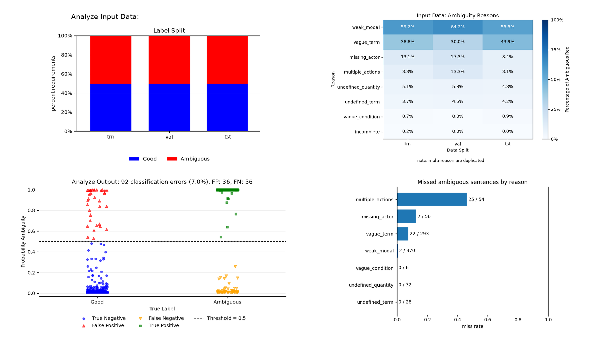

# Problem

To detect ambiguity in Natural-Language Software Requirements using the RoBERTa model

# Current Progress 

- created a common fine-tuned pipeline for RoBERTa using the annotated PURE dataset, saved the fine-tuned RoBERTa to be used by the group
- analyzed the training dataset (Human / AI-Aided)
- analyzed the test dataset and corresponding results from the fine-tuned RoBERTa

---

<!-- _class: human-layout -->
# Human Group

<table>
<tbody><tr><td>K12148218: Ostap Ohlashennyy</td><td>K12434880: Lloyd Aaron Yandoc</td></tr></tbody>
</table>
<h2>Key Findings</h2>
<ul>
<li>The label mix is generally balanced across the training, validation, and test sets.</li>
<li><code>weak_modal</code> is the most frequent annotated ambiguity reason.</li>
<li>Model probabilities are often near 0 or 1, including for some incorrect predictions.</li>
<li><code>multiple_actions</code> has the highest observed miss rate.</li>
</ul>

---

<!-- _class: human-layout -->
# AI-Aided Group

<table>
<tbody><tr><td>K12147981: Vladyslav Protsko</td><td>K12111267: Simon Stromberger</td></tr></tbody>
</table>
<h2>Key Findings</h2>
<ul>
<li>The model missed 25/28 requirements annotated with multiple actions alone, versus 0/26 with additional reasons. The contrast persists within shared-source comparisons and across length bands.</li>
<li>Clarifications noticeably lowered ambiguity scores for two of four requirements, while paraphrases barely affected them. Only the broader size/timing rewrite changed the predicted class. This small pilot shows wording sensitivity, not reliable improvement.</li>
</ul>

---